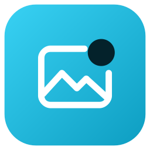
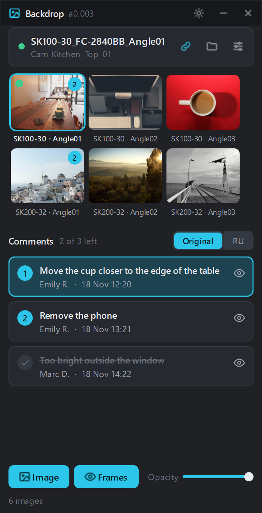
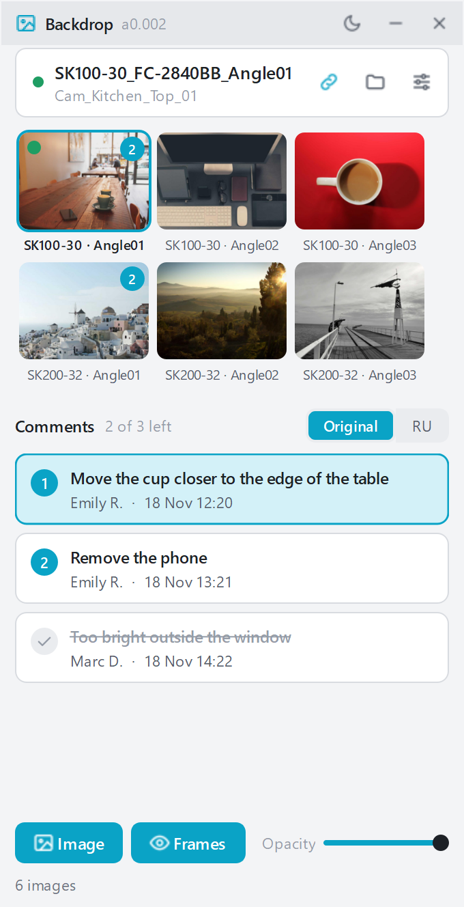
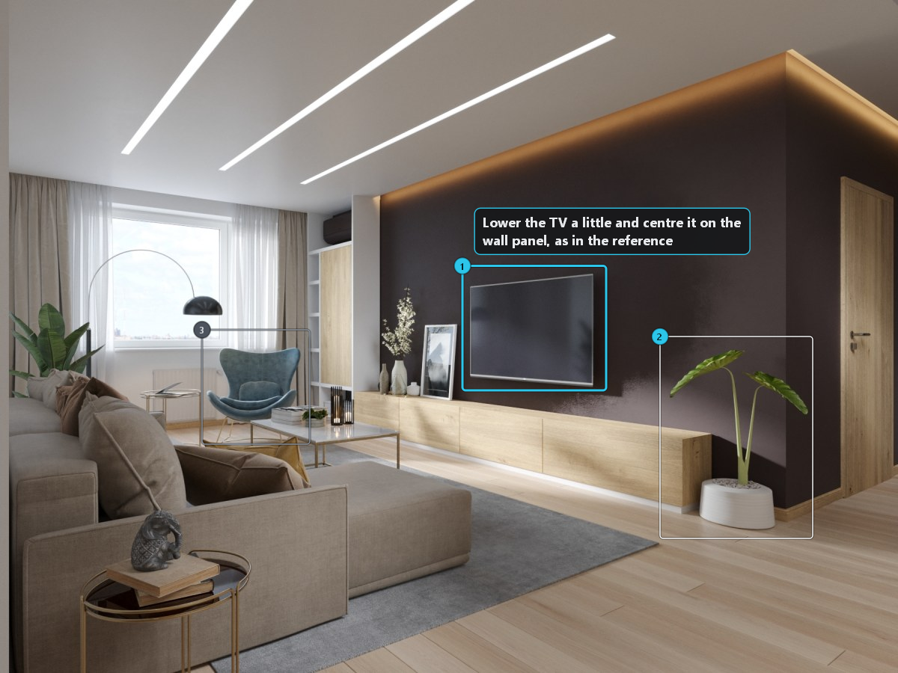
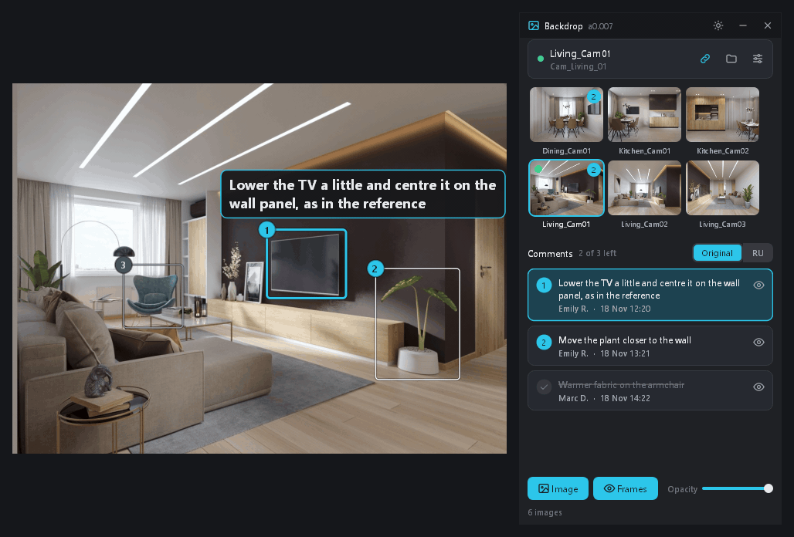

# Backdrop for 3ds Max



A floating panel for Autodesk 3ds Max that puts the image you delivered behind the
viewport and the client's comments on top of it, so corrections are made right where
they were asked for.

<p>
  
  
</p>

On the viewport every comment is a frame with a numbered pin; the one picked in the panel
is highlighted with its text:



The renders in these screenshots are the author's own work.

## Features

- **The delivered image behind the camera viewport**, fitted to the render frame. Top,
  side and perspective views stay clean.
- **Follows the scene.** The image is found by name: the file name of the render output
  (*Render Setup → Common → Render Output*) is matched against the images of a folder.
  Activating another setup in [Pulze Scene Manager](https://www.pulze.io) changes that
  field, and the picture changes with it. Any image can also be shown with a click.
- **Previews** of the folder with a badge of comments still open on each image.
- **Dropbox comments on the viewport.** The file *Download comments* saves for an image is
  picked up by its name. Every comment is a frame with a numbered pin; the one picked in
  the panel is highlighted with its text.
- **Google Drive comments by a link.** Give the link of the folder, sign in to Google in
  the browser once, and the comments of every image are fetched, see below.
- **Checklist.** A click on a pin in the list ticks the comment off; its pin goes grey.
  The eye on a card hides that comment on the viewport.
- **Translation** of the comments into Russian with DeepL and your own API key; the
  original stays under the translation.
- Text size, colours and opacity of the frames.
- **Dark and light** palettes, picked from the 3ds Max colour scheme or with the button in the title bar.
- Rolls up into its title bar and parks at the bottom of the 3ds Max window.

| Action | How |
| --- | --- |
| Choose the folders | folder button in the header |
| Show an image by hand | click its preview |
| Highlight a comment on the viewport | click its card (click again to let go) |
| Tick a comment off | click the pin on its card |
| Hide one comment on the viewport | click the eye on its card |
| Copy a comment, open or copy a link in it | right click on its card |
| Fetch comments from Google Drive | folder button → *Google Drive link…* |
| Switch between the comments of Dropbox and of Drive | folder button → *Comments from: …* |
| Open the Google Drive guide | folder button → *How to connect Google Drive…* |
| Forget the folders of the scene | folder button → *Clear the folders of this scene* |
| Text size, colours, DeepL key | sliders button in the header |

## Comments

In Dropbox open the image, then *Comments → ⋯ → Download comments*. Leave the file in
Downloads, put it next to the images, or choose a folder for comment files in the folder
menu. The name Dropbox gives it (`<image name> Dropbox File Comments.txt`) is how the
panel finds it; of several downloads the newest is used.

### Google Drive

Drive has no download for comments, but its API gives them with the place on the image.
The panel fetches them by a link, after you sign in to Google in your browser.

**Step by step, with what to do when something goes wrong: [docs/google-drive.md](docs/google-drive.md).**
In short:

1. Once per computer: make an OAuth client of the type *Desktop app* in Google Cloud
   Console (free), download its JSON file and pick it with *folder button → Google client
   file…*.
2. Per scene: *folder button → Google Drive link…*, paste the link of the folder with the
   images or of one image. The first time the browser opens Google's sign-in.
3. *Fetch the comments again* refreshes them later.

A comment is matched to a local image by the file name, so the images in Drive must be
named like the ones in the image folder. The panel asks for read-only access to Drive and
reads the list of images of the linked folder and their comments, nothing else.

A scene shows the comments of one service at a time: *folder button → Comments from:
Dropbox files* or *Google Drive*. A fetch switches to Drive; removing the link or signing
out switches back.



The comments in it are made up for the picture.

Without a sign-in a saved answer of the API is read too (with *Comments from: Google
Drive* chosen):

1. Open [comments.list](https://developers.google.com/workspace/drive/api/reference/rest/v3/comments/list)
   and its *Try this method* form (the **API** icon at the right edge in a narrow window).
2. `fileId` is the part of the image's link between `/d/` and `/view`; `fields` is `*`.
   *Execute*, signed in to the account that can see the file.
3. Save the answer as `<image name> Google Drive Comments.json` in the same places a
   Dropbox file is looked for.

Drive does not number comments, so they are numbered by the time they were made. The place
of a comment is read from a field Google does not document; if that ever changes, the
comments stay in the list without frames.

Other clouds are planned, see [ROADMAP.md](ROADMAP.md).

## Translation

Get an API key from DeepL (the free API plan is enough), then *sliders button → DeepL API
key…*. The panel checks the key and shows how much of its quota is used. Only comments
written in Latin letters are sent, each once; translations are kept in
`%LOCALAPPDATA%\AD Tools\Backdrop\translations.json`. The key is stored in the settings
of your Windows account, as plain text. The text of the comments goes to DeepL.

## Requirements

3ds Max with Python 3 and `qtmax`. Tested in **3ds Max 2024** (PySide2) and
**3ds Max 2026** (PySide6); the same file runs in both. Other versions are untested.
Windows only.

## Install

1. Download `Backdrop.mzp` from the [latest release](https://github.com/Shimodos/Backdrop/releases/latest).
2. Drag it onto a 3ds Max viewport (or *Scripting → Run Script*).
3. *Customize → Customize User Interface → Toolbars*, category **AD Tools**,
   drag **Backdrop** onto a toolbar.

The installer copies `backdrop.py` to `<user scripts>\python`, the toolbar icons to
`<user icons>` and defines the `Backdrop` macro.

To try it without installing: *Scripting → Run Script* → `src/backdrop.py`.

## Development

```
src/backdrop.py           the whole tool, one file
installer/                install.ms, mzp.run and toolbar icons
tests/                    checks that run inside 3ds Max
tools/build_mzp.ps1       builds dist/Backdrop_<version>.mzp
tools/make_icons.ps1      draws the toolbar icons and docs/icon-256.png
tools/make_shots.ps1      renders docs/shots (the screenshots and the animation; needs ffmpeg)
```

Tests drive the real panel inside 3ds Max through `3dsmaxbatch.exe` (no window is shown)
on every installed version:

```powershell
pwsh tests/run_tests.ps1            # all installed versions
pwsh tests/run_tests.ps1 -Years 2026
```

One check calls the real DeepL server with a made-up key; it is skipped without a network.

Screenshots are rendered the same way, from the panel itself rather than from the screen:

```powershell
pwsh tools/make_shots.ps1
```

A release is built by GitHub Actions when a `v*` tag is pushed.

## Notes on the 3ds Max API

Found while testing, in case they save someone an evening:

- `python.ExecuteFile` runs every script in the one shared `__main__` namespace: two tools
  with a function of the same name replace each other's. This file loads itself again as a
  module of its own and hands `__main__` back as it found it.
- Under `python.ExecuteFile`, `__file__` can still name the script that ran before; the
  code object of a function knows its own file.
- The text of the `gw` viewport methods has one fixed font, and with Nitrous they only draw
  from a redraw callback. The frames here are painted by a transparent, click-through Qt
  window kept over the camera viewport.
- `viewport.DispBkgImage` belongs to the active viewport and every viewport keeps its own.
  To switch the image on in another one, `viewport.activeViewport` is changed for a moment.
- There is no callback for a change of the render output path; it is polled.
- `urllib` fails with "certificate has expired" when the Windows certificate stores hold
  expired certificates, which they usually do: Python loads them all. The SSL context is
  built from the stores without the expired ones.
- A Python exception raised while a `QPainter` is active takes the whole 3ds Max process
  down, so painting is wrapped in `try / finally: painter.end()`.

## License

MIT. Icons in the panel are drawn in the style of [Lucide](https://lucide.dev) (ISC).

Autodesk and 3ds Max are trademarks of Autodesk, Inc. Dropbox, Google Drive, DeepL and Pulze are
trademarks of their owners. This script is not affiliated with any of them.
