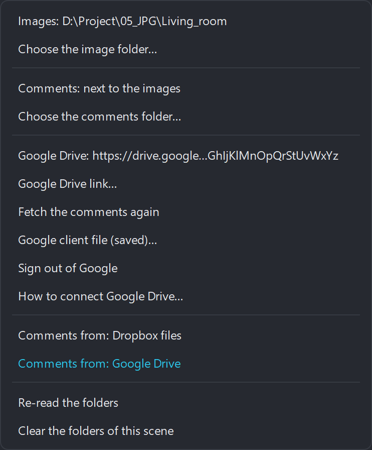
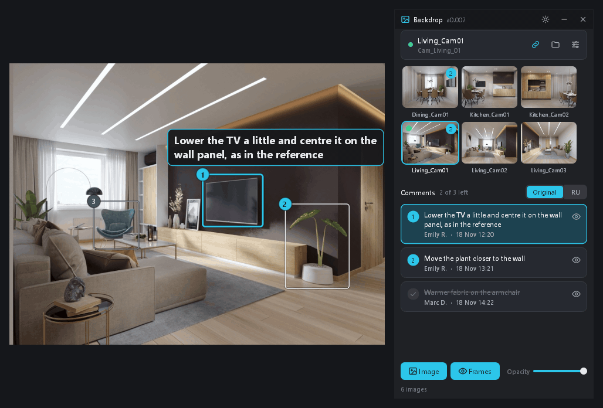

# Comments from Google Drive

Backdrop can take the comments your client left on the images in Google Drive and draw
them over the viewport. You paste the link of the Drive folder, sign in to Google in your
browser, and the comments of every image arrive in the panel.

This page opens from the panel: **folder button → How to connect Google Drive…**

There are two parts:

- **[Part 1](#part-1-your-google-client-once)** is done **once per computer**, takes about
  ten minutes and is free. You make a small "key" file in Google Cloud Console that lets
  the panel show Google's sign-in page.
- **[Part 2](#part-2-the-link-per-scene)** is done **per scene** and takes a minute.

Why Part 1 is needed at all: Google lets a program sign a user in only if the program is
registered with Google. Backdrop has no registration of its own yet, so you register your
own copy. Nobody but you can use it.

## Before you start

- A Google account that **can open the Drive folder** with the images.
- The images in Drive must be **named like the images on your computer**
  (`Kitchen_Cam01.jpg` in Drive ↔ `Kitchen_Cam01.jpg` in the image folder of the panel).
  The name is how a comment finds its image.

## Part 1. Your Google client (once)

### 1. Make a project

1. Open [console.cloud.google.com](https://console.cloud.google.com) and sign in.
2. At the top, click the project name → **New project**. Any name will do, for example
   `Backdrop`. **Create**, then make sure this project is the one selected at the top.

### 2. Switch the Drive API on

1. In the search field at the top type **Google Drive API** and open it.
2. Click **Enable**. If you see **Manage** instead, it is on already.

### 3. Register the app

1. Open the menu **☰** → **Google Auth platform**.
2. Click **Get started** and fill the form:
   - *App name*: `Backdrop`; *User support email*: your address
   - *Audience*: **External**
   - *Contact information*: your address
   - agree to the policy, **Create**.

   If there is no *Get started* button, the project is registered already: go on.
3. In the menu on the left open **Audience**. Under *Publishing status* it must say
   **In production**. If it says *Testing*, click **Publish app**.

   > In *Testing* Google signs you out every seven days. *In production* it does not.

### 4. Make the client and download its file

1. In the menu on the left open **Clients** → **Create client**. In a narrow window the
   button hides behind **⋮** next to the heading *Clients*.
2. *Application type*: **Desktop app**. Name: `Backdrop`. **Create**.
3. In the window that appears click **Download JSON**. You get a file named
   `client_secret_….apps.googleusercontent.com.json`. Keep it somewhere of your own:
   Google shows the download only at this moment.

### 5. Give the file to the panel

In Backdrop: **folder button** → **Google client file…** → pick the downloaded file.
The status line at the bottom says *Google client saved.*, and the menu item becomes
*Google client file (saved)…*.

Part 1 is done. You will not need the console again.

## Part 2. The link (per scene)

1. In Google Drive open the folder with the images and copy its link (the address of the
   folder from the browser will do). A link of a single image works too.
2. In Backdrop: **folder button** → **Google Drive link…**, paste the link, **OK**.
3. **The first time only**, your browser opens Google's sign-in:
   - choose your account;
   - Google says *Google hasn't verified this app*. That is expected, the app is your own
     client from Part 1: click **Advanced**, then the link that goes on to *Backdrop*;
   - allow the access to Drive (Google words it as viewing and downloading all your
     Drive files) and continue.

   The tab then says *Signed in. This tab can be closed.* Go back to 3ds Max.
4. The status line of the panel says, for example, *Google Drive: 5 comments on 2
   images.* The images with comments get a badge with their number; click one to see
   its frames on the viewport.

Later, when the client adds comments: **folder button** → **Fetch the comments again**.
No sign-in is asked for.

The folder menu once Google Drive is set up, with everything named above:

## Dropbox and Google Drive together

A scene shows the comments of one service at a time, never a mix. The folder menu says
which, and switches:

| Menu item | What is shown |
| --- | --- |
| *Comments from: Dropbox files* | the files downloaded from Dropbox (default) |
| *Comments from: Google Drive* | the comments of Google Drive, fetched anew when you switch to it |

The panel switches by itself where the choice is obvious: a fetch from Google Drive shows
Drive; removing the link or *Sign out of Google* goes back to the Dropbox files.

## If something goes wrong

| What you see | What to do |
| --- | --- |
| *Google Drive: choose the Google client file first* | Part 1, step 5: the panel has no client file yet. |
| *Not a Google client file* | The wrong file was picked. It is the one from *Download JSON*, its name starts with `client_secret_`. |
| *Not a Google Drive link.* | The link must be of `drive.google.com`: a folder (`…/folders/…`) or a file (`…/file/d/…`). |
| *Google: the sign-in was not finished in the browser.* | The browser was closed or five minutes passed. *Fetch the comments again*. |
| *Google: the sign-in was refused (access_denied).* | *Cancel* was pressed on Google's page. Fetch again and allow the access. |
| *Google Drive: this account has no access to the link* (403) | You signed in with an account that cannot open the folder, or the Drive API is off: Part 1, step 2. |
| *Google Drive: nothing found by this link for this account* (404) | The link is wrong, or the folder is not shared with the account you signed in with. |
| *Google: signed out. Fetch again to sign in.* | Google ended the sign-in. Fetch again: the browser opens once more. |
| *Google Drive: no comments.* | The images of the folder have no comments, or they were made on another folder. |
| *Google Drive: no link yet* | *Comments from: Google Drive* was chosen in a scene without a link: Part 2, step 2. |
| The status counts comments, but an image shows none | The image in Drive is named differently from the one on your computer, or *Comments from: Dropbox files* is chosen. |
| Frames are in the wrong places | The image in Drive is another version (another crop or camera) than the one in the image folder. |

## What the panel can see and where things are kept

- The panel asks Google for **read-only** access to Drive (`drive.readonly`); Google has
  no narrower permission that opens a file by its link. It reads the list of images of
  the linked folder and their comments. It does not download the images and changes
  nothing in Drive.
- Everything goes straight from your computer to Google. There is no server of Backdrop.
- The fetched comments are kept in `%LOCALAPPDATA%\AD Tools\Backdrop\drive`.
- The client and the sign-in are stored in the settings of your Windows account, as
  plain text.
- **Sign out of Google** in the folder menu forgets the sign-in on this computer. To take
  the access back altogether, remove *Backdrop* from the apps with access in the security
  settings of your Google account.
- An unverified client like this one can sign in **100 Google accounts** in all. For you
  and your colleagues that is plenty; each studio makes its own client.

## Limits

- Replies to a comment and comments marked as resolved are not treated separately yet: a
  resolved comment is shown like any other.
- Google does not document how the place of a comment on an image is stored. The panel
  reads what Drive writes today; should that change, the comments stay in the list
  without frames.
- Drive does not number comments. The panel numbers them by the time they were made.
